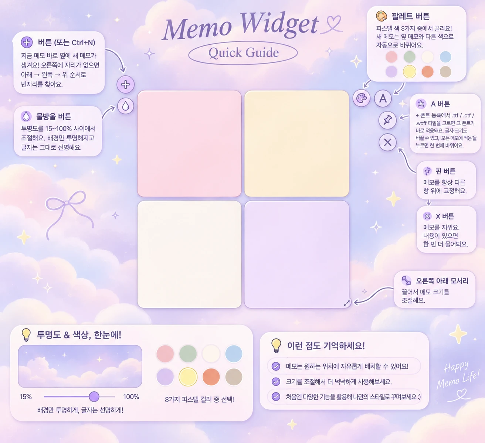

<p align="center">
  
</p>

<p align="center">
  
</p>

<h1 align="center">Pastel Memo</h1>

<p align="center">Windows 바탕화면에 붙여 두는 파스텔 톤 메모 위젯</p>

---

## 다운로드

[**Releases**](https://github.com/mirolx/pastel-memo-widget/releases/latest) 페이지에서 받으세요.

| 파일 | 설명 |
|---|---|
| `PastelMemo-Setup.exe` | 설치 버전 — 바탕화면/시작 메뉴 바로가기 생성, 제거 가능 |
| `PastelMemo-portable.exe` | 설치 없이 바로 실행 |

> **"Windows의 PC 보호" 창이 뜨면?**
> 코드 서명이 없는 개인 프로젝트라서 나오는 경고예요. **추가 정보 → 실행**을 누르면 됩니다.

## 기능

- **옆에 붙는 새 메모** — ＋ 버튼(또는 `Ctrl+N`)을 누르면 지금 메모 바로 옆 빈자리에 새 메모가 생겨요.
- **토글 버튼** — 화면 오른쪽 위 동그란 버튼으로 모든 메모를 숨기고 보여요. 버튼에서 가까운 메모부터 차례로 펼쳐지는 가벼운 모션이 있어요. (우클릭: 새 메모)
- **투명도 조절** — 배경만 투명해지고 글자는 선명하게 유지돼요.
- **파스텔 컬러 8가지** — 로즈우드 · 세이지 · 크림 · 스카이 · 라벤더 · 레몬 · 로즈 · 모카
- **폰트 등록** — `.ttf` / `.otf` / `.woff` 파일을 등록해서 메모 폰트로 쓸 수 있어요.
- **스타일 동기화** — 폰트, 글자 크기, 투명도는 모든 메모에 함께 적용돼요. 색은 메모마다 따로.
- **항상 위에 고정**, 크기 조절, 자동 저장, 트레이 메뉴, Windows 시작 시 실행

## 단축키

| 키 | 동작 |
|---|---|
| `Ctrl+Alt+M` | 메모 전체 숨기기 / 보이기 |
| `Ctrl+Alt+N` | 새 메모 |
| `Ctrl+N` | (메모 안에서) 옆에 새 메모 |
| `Esc` | 열린 설정 창 닫기 |

메모 데이터는 `%APPDATA%\Pastel Memo\memos.json`에 저장돼요.

## 직접 빌드하기

[Node.js](https://nodejs.org) 18 이상이 필요해요.

```bash
npm install
npm start        # 개발 모드로 실행
npm run dist     # dist/ 폴더에 exe 생성
```

## 라이선스

[MIT](LICENSE)
